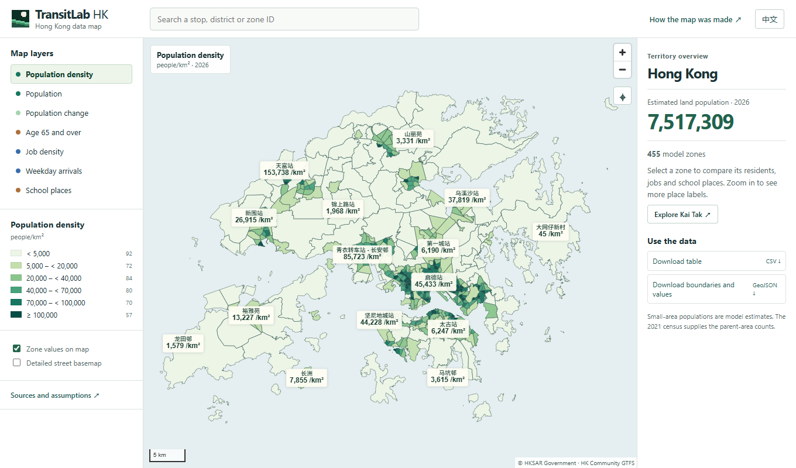

# TransitLab HK

A public data map of Hong Kong’s population, jobs, weekday arrivals and school places across 455 model zones. The map opens on 2026 estimated population density. Select a neighbourhood to compare its population with 2021, or download the same numbers for your own analysis.

[Open the map](https://senpagavv.github.io/transitlab-hk-map/) · [中文使用说明](docs/guide.zh.md) · [Data sources and methods](docs/methods.md)



## Try Kai Tak

1. Open the map and select **Explore Kai Tak**, or search for zone **286.2**. The map also accepts district names and transport stops.
2. The inspector shows **30,034** allocated residents in 2021 and **84,141** estimated residents in 2026. The estimate is for the whole model zone around the station.
3. Switch between **Population** and **Population density**. The first counts residents. The second divides by the original model area. Each legend class shows how many zones it contains.
4. Zoom in for more local labels. Turn on **Detailed street basemap** for the Lands Department backdrop. The default view draws all analytical layers and labels from the downloaded snapshot.

## Download or run locally

The [CSV table](public/data/zones.csv) opens in Excel or Python. Keep the `zone` and `parent` identifiers as text. The [GeoJSON](public/data/zones-2026.geojson) opens directly in QGIS and includes both geometry and attributes. Both downloads are also available inside the map. [Field definitions and reuse terms](docs/methods.md)

To rebuild the map data, use Python 3.10 or later. Its standard library is sufficient.

```sh
python scripts/build_map.py
```

The build recalculates the population from 211 parent-area controls and 455 local zone weights, writes both downloads, and reports **7,517,309 estimated land residents**. Employment, trips and school places come from the original frozen model outputs. [Calculation details](docs/methods.md)

To run the interface, install Node.js 24 and run the following from the repository root.

```sh
npm ci
npm run dev
```

Open the local address printed in the terminal. For a production build run `npm run build` and serve the resulting `dist/` directory. The interface uses relative paths and can be hosted under a subdirectory. [Use and attribution](USE.md)
